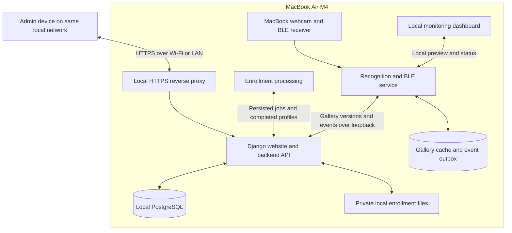

# PNP Access Verification System — Major Revision Plan

Status: Core same-network prototype implemented and running locally. Cross-device HTTPS trust and live person/BLE acceptance remain to be completed.

Prepared: 18 October 2026 (Asia/Manila).

Existing project: `/Users/utok/Documents/Programming/pnp`

Design reference: [Figma wireframes](https://www.figma.com/design/BVauQQ9Y3odWNut9NX66UI/Untitled?node-id=0-1)

## Implementation status — 18 October 2026

Implemented in `/Users/utok/Documents/Programming/pnp` with the original Flask application preserved.

- React/TypeScript admin and monitoring dashboards, Django/DRF APIs, and local PostgreSQL are installed.
- Login, password changes, staff/operator separation, personnel editing/deactivation, reviewed-profile activation, and audit records are implemented.
- Four-step enrollment supports isolated drafts, five angles with eight accepted samples each, retakes, automatic five-angle capture, and persisted processing jobs.
- The native recognition service owns camera/BLE access, refreshes gallery versions, confirms combined evidence, and queues events durably during backend failure. A dedicated capture thread feeds continuous preview streaming; recognition consumes only the newest frame and sends overlays separately. Gallery freshness is bounded at 30 seconds for grants.
- Search/filter/sort/pagination, CSV export, alert review, and truthful direction/occupancy labels are implemented.
- Seven legacy registration profiles were imported as incomplete records; fourteen old sightings remain explicitly labeled legacy sightings. Original registration files and logs are preserved.
- Local PostgreSQL, Caddy HTTPS, certificate generation, start/stop scripts, backup/restore validation, and optional launchd configuration are provided.
- Validation passed: 24 backend tests against disposable PostgreSQL, 10 worker tests, 25 existing recognition tests, TypeScript/production build, authenticated HTTPS smoke checks, and backup restoration into a disposable database.

### Remaining hands-on acceptance

- Trust the generated local CA on the MacBook and each participating admin device. The Mac keychain authorization was canceled during setup; do not assume the certificate is trusted.
- Verify access and browser webcam registration from an actual second device on the same network.
- Complete a real person's enrollment and face-plus-ESP32 verification, including sustained performance under simultaneous enrollment and monitoring.
- Review official IDs/ranks/units and BLE assignments before activating imported personnel.
- Install the generated login-startup configuration only if automatic startup is wanted. It has been generated, not installed.
- Use the legacy calibration workflow when needed; it is preserved rather than rebuilt in the new dashboard. Restart the worker after changing reviewed settings.

The built-in webcam can be started from the monitor; it is left stopped after verification. See `SETUP.md` in the project for login, local HTTPS, startup, and validation instructions.

## 1. Objective and confirmed requirements

Divide the current Face Studio prototype into two interfaces backed by a shared application and database:

1. **Admin dashboard:** same-network personnel registration, account login, personnel management, verification logs, summaries, and alert review.
2. **Monitoring dashboard:** local webcam monitoring, AI recognition, BLE checks, and verification results.

The prototype runs on one **MacBook Air M4** using its webcam. The MacBook hosts the admin website, backend, PostgreSQL database, private enrollment files, enrollment processing, and recognition service. Administrators on the same Wi-Fi or local network open the MacBook's local HTTPS address and sign in through the application login.

No paid hosting, public domain, internet tunnel, VPN, or third-party hosting account is required. The MacBook must be powered on and awake for both dashboards and processing. Internet access is not required after initial installation and model downloads, provided the local network remains available.

Registration happens through the admin dashboard. Enrollment data reaches the monitor through the backend and shared database; registration must not depend on placing the admin dashboard into the monitor's current global registration mode.

The two dashboards are separate interfaces, not separate installations with independently maintained personnel databases.

## 2. Decisions and assumptions

### Confirmed by the user

- One MacBook Air M4 hosts the website, database, and AI recognition.
- Use a webcam initially.
- Administrators connect from devices on the same local network and use application login.
- No hosting subscription or dependency on third-party hosting is required.
- Registration belongs in the admin dashboard.
- The monitor uses registered data stored through the shared database.
- The supplied Figma wireframes define the intended application functionality.

### Proposed implementation choices

- React and TypeScript for both dashboards.
- Django and Django REST Framework for authentication, business rules, and APIs.
- PostgreSQL running locally on the MacBook as the system of record.
- Private enrollment images stored on the MacBook outside publicly served static directories.
- A native Python service owns live recognition and BLE scanning.
- Enrollment jobs run locally with bounded concurrency and lower priority than live recognition. Benchmark whether a dedicated enrollment worker or serialized inference scheduling best fits available RAM.
- A local HTTPS reverse proxy serves the admin website and API from one origin. A locally trusted certificate enables browser webcam registration from other devices.
- Enrollment uses the admin device's camera; the MacBook processes samples with the same ArcFace checkpoint used for monitoring.
- BLE identifiers are assigned through the admin dashboard; physical BLE verification happens near the MacBook.
- One person in the verification zone at a time for the initial BLE-first pilot.
- A selected Entry/Exit mode provides prototype direction labels until actual passage detection is implemented.

These choices can be revised before their implementation phase. Exact RAM and sustained performance still need measurement. Render and the previous online-hosting architecture are superseded by this same-network setup.

## 3. Technology stack

| Layer | Proposed technology | Purpose |
| --- | --- | --- |
| Dashboard UI | React, TypeScript, Vite | Shared components and separate admin/monitor interfaces |
| Web backend | Django, Django REST Framework | Authentication, permissions, APIs, reporting |
| Authentication | Django sessions and permissions | Admin/operator roles and protected records |
| Database | PostgreSQL on the MacBook | Personnel, profiles, jobs, verification and audit records |
| Private files | Local protected storage | Enrollment images and permitted event snapshots |
| Recognition | Python, OpenCV, NumPy, ONNX Runtime | Reuse existing inference implementation |
| Face models | RetinaFace R34, ArcFace R50 | Detection, alignment, and embeddings |
| Tracking | Supervision ByteTrack | Associate observations across frames |
| BLE | Bleak | Evaluate assigned tag presence near the MacBook |
| Internal communication | Authenticated loopback APIs and persisted jobs | Gallery updates, processing jobs, events, health |
| Dashboard updates | Short polling initially | Display activity and service status |
| LAN HTTPS | Local reverse proxy and locally trusted certificates | Secure login and webcam access on admin devices |
| Service management | macOS launchd | Start and restart local services |

Use production web serving instead of development servers. Build React into local static assets served from the same HTTPS origin as the backend; no Node development server is needed for normal operation. Avoid externally hosted fonts, scripts, or other required runtime assets so the prototype can operate without internet.

Start ONNX Runtime with CPU inference. Benchmark optional CoreML, including score consistency, before changing the default. Docker, Redis, Celery, and Kubernetes are not required for this prototype. Keep camera and Bluetooth access native to macOS.

## 4. Architecture

### Local deployment layout

- **LAN website:** one HTTPS origin for the built admin frontend and Django API.
- **Database:** PostgreSQL listens only on loopback or a local socket. Other devices access application APIs, never the database directly.
- **Enrollment:** local background processing uses persisted jobs and the private image directory, with bounded CPU/RAM use.
- **Monitoring:** the native service owns the webcam and BLE receiver. Its preview and control interfaces remain local to the MacBook.
- **Storage:** images, profiles, queued events, and database files persist on the MacBook across application restarts.
- **Startup:** launchd supervises the local services; stop/restart instructions are documented.

### Responsibility boundaries

- The backend owns persistent records, permissions, enrollment activation, and event ingestion.
- The recognition service owns hardware, models, tracking, and verification state.
- The monitor displays the service output. Refreshing or closing the page does not stop recognition.
- Browser clients never connect directly to PostgreSQL. The recognition service uses a protected loopback API with a scoped service credential.
- Only intended web/API routes are available on the local network. Do not configure router port forwarding or public exposure.
- Live monitoring video remains local. Admin devices receive permitted records and snapshots, not an automatically exposed stream.

### Service behavior

The recognition service maintains a versioned local gallery cache and a durable event outbox for brief backend failures. Event retries use unique IDs to prevent duplicate records.

Internet loss does not interrupt the local system. Wi-Fi/LAN loss disconnects other admin devices but should not interrupt the MacBook's webcam, recognition, database, or loopback communication. Browser drafts not yet saved must be clearly marked and retried when connectivity returns.

A backend outage delays record changes and enrollment; cached recognition may continue with a degraded status. Define a gallery-freshness bound before acceptance testing so the monitor does not claim current authorization for potentially revoked personnel. A fresh installation without a valid gallery cannot recognize registered personnel during a backend outage.

If the MacBook sleeps, shuts down, or restarts, the website, enrollment processing, and recognition are unavailable until services recover. Persist in-progress jobs and recover or retry them after restart.

## 5. Figma functionality and scope

The Figma review covered page metadata, the admin overview screenshot, and the Gate 1 monitor screenshot. Detailed implementation must revisit individual screens and interaction states rather than treating this plan as a complete visual specification.

### Admin dashboard

- Administrator login, invalid-login feedback, logout, and expired-session handling.
- Dashboard cards for verification activity and alerts.
- Latest verification with personnel details, BLE evidence, timestamp, and result.
- Recent activity and links to full records.
- Alerts requiring review, with reviewer, outcome, and notes.
- Searchable personnel directory with personnel ID, name, rank/position, unit, BLE assignment, enrollment date, and status.
- Add, edit, and remove/deactivate actions with permission checks.
- Searchable and sortable verification logs with date, status, direction, personnel, and beacon filters.
- Export records within the administrator's permitted scope.
- Real service health for camera, recognition, BLE, and backend connectivity.

### Four-step registration

1. Personnel information: personnel ID, full name, rank/position, unit/department.
2. BLE assignment: assign an identifier and reject conflicting active assignments.
3. Facial enrollment: guided front, left, right, up, and down samples, quality feedback, previews, and retakes.
4. Review and save: display completeness and explicitly activate the enrollment after successful processing.

Support autosaved drafts, incomplete status, cancellation, retry, and a completion screen. Retain the existing eight samples per angle as the initial capture policy unless validation supports changing it; five angle cards do not imply only five source images.

### Monitoring dashboard

- Local live webcam feed and face overlays.
- Gate/station identification and current time.
- Verification sequence: BLE detected, face confirmation, final result.
- Matched personnel details and assigned BLE identifier.
- Pending, granted, denied, ambiguous, and service-unavailable states.
- Clear distinction between face similarity and detector confidence.
- Selected prototype direction mode.
- Restricted operator controls; no unrestricted personnel administration.

Do not display synthetic service-ready states or controller acknowledgments. The wireframe's gate-controller delivery and relay status require actual integration and are deferred unless explicitly added to scope.

## 6. Registration and gallery update flow

1. An authenticated administrator creates a draft personnel record.
2. The administrator assigns a known BLE identifier. Scanning on the MacBook only discovers tags physically near the MacBook; it cannot discover tags near another admin device.
3. The administrator's browser requests its own camera permission and collects guided samples under a unique enrollment session.
4. Samples upload to the backend with type, size, count, and session ownership validation.
5. A persisted enrollment job is made available to the MacBook's local enrollment processing service.
6. The local worker validates faces, quality, and pose coverage, then creates normalized ArcFace embeddings with a recorded model identifier matching the live recognition model.
7. The backend saves a completed profile version. Failed or incomplete jobs cannot enter the active gallery.
8. Review and Save activates the complete enrollment transactionally and increments the gallery version.
9. The recognition service fetches the new gallery version through loopback, validates it, atomically replaces its cache, and acknowledges loading. The admin dashboard distinguishes saved enrollment from enrollment loaded by the monitor. If the recognition service is temporarily stopped, completed enrollment remains pending its next gallery refresh. When the MacBook is off, registration is unavailable.

Enrollment runs as bounded local background work, separate from web requests, with live recognition taking priority. Measure combined model memory and sustained CPU load on the MacBook. Multiple admins have isolated sessions; retries cannot mix identities or overwrite another draft. One physical camera has one owner. An admin can use another device's camera while monitoring continues; same-Mac enrollment needs an explicit capture-sharing or scheduled enrollment workflow.

Uploaded photographs can be supported as a controlled alternative, but must pass the same quality and completeness checks. Browser enrollment is not liveness verification.

## 7. Verification policy and event lifecycle

### BLE-first prototype sequence

1. Detect a fresh BLE advertisement that meets the configured signal policy.
2. Resolve the identifier to one active enrolled person.
3. Locate a usable face in the verification zone and compare it against that person's profile.
4. Require sufficient quality and temporal agreement within a bounded verification window.
5. Evaluate personnel status, gallery freshness, BLE evidence, and face evidence together.
6. Persist one final attempt result with its evidence and reason.
7. Update the monitor, admin summaries, and alert queue.

Proposed outcomes include verified, face mismatch, missing BLE, unknown tag, unidentified face, ambiguous attempt, timeout, inactive personnel, and service unavailable. A visible face without a valid tag must still produce a bounded missing-BLE or unidentified attempt rather than silently disappearing from logs.

Do not use the strongest BLE signal alone to associate a beacon with a person in a crowd. If multiple candidates remain ambiguous, do not grant automatically. Static advertisement identifiers provide proximity evidence, not cryptographic proof of tag ownership; stronger anti-replay verification is a separate hardware enhancement.

Use per-attempt state and cooldown rules to avoid writing an event every frame. Persist the profile/model and recognition-setting versions needed to interpret a result. Any event snapshot policy must define when snapshots are captured, access permissions, and retention.

## 8. Entry, exit, and occupancy

The current code records face sightings, not physical crossings. The initial webcam prototype will use an operator-selected Entry/Exit mode and store `direction_source=operator_mode`.

Verification approval is separate from a passage event. Do not calculate authoritative occupancy from approved attempts, or alternate a person's direction after each sighting.

The wireframe's entries, exits, and people-inside cards must either show clearly labeled prototype verification counts or remain unavailable until reliable passage detection is added. Future passage detection may use dedicated lanes/cameras, validated directional tracking, or physical sensors. It also needs duplicate handling and occupancy correction rules.

## 9. Data model

| Entity | Main responsibilities |
| --- | --- |
| User and Role | Admin/operator accounts, permissions, login lifecycle |
| Personnel | Unique official ID, identifying fields, status, enrollment timestamps |
| BLEAssignment | Identifier, person, active period, reassignment history |
| EnrollmentSession | Owner, draft fields, capture progress, errors, completion state |
| EnrollmentSample | Private image reference, pose, quality results, capture provenance |
| FaceProfile | Personnel, model ID, embeddings, reference vector, profile version, active state |
| RecognitionSettings | Reviewed thresholds, calibration evidence, version |
| Station | Gate identifier, configured direction mode, heartbeat and health |
| VerificationAttempt | Unique event ID, station, identity if known, evidence, decision and reason |
| PassageEvent | Actual crossing evidence; deferred until supported |
| AlertReview | Attempt reference, reviewer, resolution, notes, timestamps |
| AuditEvent | Actor, action, target, timestamp, relevant before/after changes |
| ProcessingJob | Persisted enrollment jobs, leases, retries, completion status |

Separate application users from enrolled personnel. Store timestamps in UTC and display/filter days in Asia/Manila. Keep historical identity snapshots so later edits do not rewrite old logs. Deactivation immediately excludes a person from the active gallery once the updated version is loaded. Permanent deletion needs a defined retention policy and must not cascade-delete verification history accidentally.

## 10. Same-network hosting and operations

- Connect the MacBook and admin devices to the same LAN. Verify that guest-network/client isolation and firewall rules do not block communication; the same Wi-Fi name alone does not guarantee reachability.
- Use a stable local address, preferably a router DHCP reservation for the MacBook. A local hostname may be used where name resolution works reliably; document an IP-based fallback.
- Configure HTTPS for the exact hostname or IP clients use. Browser camera capture on another device needs a trusted secure context; plain HTTP to the MacBook's LAN IP is not the localhost exception.
- Generate a local certificate authority and a certificate with the correct hostname/IP names. Install and trust the CA certificate on each participating admin device according to its OS/browser. Keep the CA private key on the host and never distribute it. A certificate-warning bypass is not an accepted camera-access setup.
- Verify browser webcam capture on the actual demo devices after certificate setup. If a device cannot establish trusted HTTPS, use a supported configured device or explicitly permitted image upload; do not bypass browser security controls.
- Expose only the HTTPS website to the intended local network. Keep PostgreSQL, enrollment controls, model files, and local preview/control endpoints private. Do not configure router port forwarding, tunnels, or public DNS.
- Use application login, secure session cookies, CSRF protection, login throttling, session expiration, and server-side permissions. Bootstrap the first admin locally; public admin self-registration is out of scope.
- Configure allowed hosts, trusted origins, and reverse-proxy headers for the documented local addresses. Validate loopback API credentials separately from browser sessions.
- Serve biometric images through authorized routes; keep private files outside static assets and avoid shared caching.
- Keep secrets outside source control. No Render, Cloudflare, VPN, or external hosting credentials are required. Local admin and database credentials are created during setup.
- Keep the MacBook powered and awake throughout demonstrations. Configure and test service restart, camera/Bluetooth permissions, database startup, and interrupted-job recovery.
- Back up local database records and private files consistently to a separate protected destination, and verify restoration. Define retention and cleanup for samples, drafts, snapshots, audit records, and queued events.
- Show health, last gallery acknowledgment, and event-ingestion status accurately. Wi-Fi failure affects admin connectivity; backend failure affects persistence; whole-host failure affects all functions.
- There is no hosting subscription. Existing hardware, local networking, storage, and electricity are still needed. Download dependencies and models before an offline demonstration.

## 11. Migration from the existing application

Preserve and reuse the RetinaFace/ArcFace adapters, alignment, normalized embedding logic, quality gates, tracking, and calibration evaluation where appropriate. Replace the shared global Flask registration state with per-session persisted workflows.

Before migration, make a recoverable copy of registration data, settings, and logs. Import existing person folders into database records without deleting or rewriting the originals. Missing official personnel details or BLE assignments produce incomplete records requiring review; do not invent values.

Validate profile dimensions and checkpoint identifiers. Existing ArcFace profiles may be imported if compatible; legacy SFace profiles must not be mixed into the ArcFace gallery.

Import `entries.jsonl` as legacy face sightings, explicitly distinguished from verified access attempts and passages. Preserve original timestamps and source identifiers. Fix the stale `TAG_UUID_MAP` pairing dependency when replacing BLE assignment endpoints.

Retain calibration as a restricted local/operator workflow and version applied settings. Update documentation where the README differs from current behavior. Keep the original application usable until the revised local pipeline and migration have passed acceptance checks.

## 12. Implementation phases

### Phase 1 — Requirements and foundations

- [ ] Confirm role permissions, BLE requirement, ambiguity policy, and prototype direction behavior.
- [ ] Confirm whether physical gate control is excluded from the first release.
- [ ] Inspect detailed Figma screens and map visible actions to requirements.
- [x] Establish project structure, configuration, database schema, and migration strategy.

Exit condition: agreed interface/API boundaries, data model, and measurable acceptance criteria.

### Phase 2 — Backend and persistence

- [x] Build accounts, sessions, permissions, personnel records, and audit logging.
- [x] Build enrollment sessions, local processing jobs, gallery versions, and idempotent event ingestion.
- [x] Add station credentials, heartbeat tracking, gallery refresh, and version acknowledgments.
- [x] Add log search, filters, pagination, export, and alert review APIs.
- [x] Implement and verify reversible legacy imports.

Exit condition: authenticated APIs support the main workflows with transactional validation and preserved legacy data.

### Phase 3 — Recognition service and monitor integration

- [x] Extract model, webcam, BLE, and tracking ownership into a persistent local service.
- [x] Add authenticated loopback communication, versioned gallery loading, health reporting, and settings loading.
- [x] Add a persistent local gallery cache and event outbox with reconnect recovery.
- [x] Implement BLE-first attempt state and unified final decisions.
- [x] Add durable event retries and duplicate protection.
- [x] Build the monitor's local preview and result presentation.

Exit condition: local recognition continues across dashboard refreshes and internet loss; results persist without duplicate ingestion.

### Phase 4 — Same-network admin enrollment

- [x] Build the four-step admin registration wizard with autosaved drafts.
- [x] Add guided automatic capture, quality results, retakes, and local asynchronous processing.
- [ ] Verify guided camera registration from another device using trusted local HTTPS.
- [ ] Verify enrollment scheduling preserves live recognition responsiveness and survives service restarts.
- [x] Enforce BLE assignment uniqueness and personnel ID uniqueness.
- [x] Activate profiles only after successful completion and review.
- [x] Show monitor acknowledgment of the activated gallery version.

Exit condition: a person enrolled on another device becomes available to the live monitor without restarting it or mixing concurrent sessions.

### Phase 5 — Admin dashboard

- [x] Implement the Figma login, overview, personnel directory, and logs screens.
- [x] Add edit/deactivate actions, review history, exports, and accurate health indicators.
- [x] Distinguish verification counts from passage/occupancy statistics.
- [x] Reconcile wireframe states and confirm responsive browser behavior.

Exit condition: displayed records, summaries, and actions reflect actual backend state and role permissions.

### Phase 6 — Hosting and acceptance

- [x] Install the website, backend, PostgreSQL, private files, and enrollment processing on the MacBook.
- [ ] Configure a stable local address, LAN HTTPS, client certificate trust, and firewall access.
- [x] Configure local service credentials, loopback integration, and automatic startup.
- [ ] Test registration and administration from another LAN device during sustained recognition.
- [ ] Test internet disconnection separately from Wi-Fi loss, MacBook sleep, and whole-host restart.
- [x] Test failures, recovery, backup restoration, gallery updates, and audit history.
- [x] Document setup, operations, known limits, and demonstration procedure.

Exit condition: an authorized admin on the same network can enroll personnel and review real verification events while the MacBook monitor continues operating.

## 13. Acceptance checks

- An unauthenticated or unauthorized browser cannot access personnel data, images, exports, or management actions.
- Two administrators can maintain independent drafts without mixing face samples.
- Invalid images, ambiguous captures, incompatible models, duplicate IDs, and conflicting BLE assignments are rejected.
- Enrollment processing does not starve the live camera pipeline; measure and agree the acceptable sustained frame rate and enrollment time on the M4.
- Active profiles refresh without a process restart; incomplete profiles never enter the gallery.
- Correct face plus assigned fresh BLE evidence produces the intended result; wrong, missing, stale, or ambiguous evidence cannot grant automatically.
- Backend retries preserve exactly one stored record per event ID.
- Refreshing a dashboard does not reset camera ownership or stop recognition.
- Disconnecting internet while keeping the LAN active preserves login, registration, recognition, and logging without external runtime assets.
- Losing LAN connectivity disconnects admin devices while MacBook recognition continues. A backend outage queues events; recovery ingests them without duplicates.
- Admin devices capture faces over trusted local HTTPS with camera permission; database and worker ports are inaccessible from those devices.
- MacBook sleep/shutdown makes the website and recognition unavailable; startup restores saved records and recovers interrupted jobs.
- Inactive personnel and tag reassignment propagate through gallery versions within the agreed freshness bound.
- Exports match filters and permissions; local-day date ranges respect Asia/Manila.
- No interface claims physical passage, authoritative occupancy, or controller acknowledgment without supporting evidence.
- Restoring a backup recovers consistent personnel, face profiles, images, and history.

## 14. Deferred scope

- Multiple gates or independent monitoring computers.
- Reliable entry/exit crossing detection and occupancy accounting.
- Physical relay/turnstile integration and delivery acknowledgments.
- Remote live-video viewing.
- Production liveness and anti-spoofing protection.
- Cryptographically authenticated BLE tags and replay resistance.
- Website access from outside the local network.
- Website availability or recognition while the MacBook is unavailable.
- Cloud hosting, public domains, tunnels, and advanced availability guarantees.

## 15. Technical references

- [Django authentication and permissions](https://docs.djangoproject.com/en/5.2/topics/auth/default/)
- [Django deployment checklist](https://docs.djangoproject.com/en/5.2/howto/deployment/checklist/)
- [Vite production builds](https://vite.dev/guide/build.html)
- [PostgreSQL documentation](https://www.postgresql.org/docs/current/)

The implementation status above distinguishes completed software work from remaining device and hardware acceptance. Validate certificate trust, LAN reachability, camera/Bluetooth permissions, and sustained performance before the demonstration.
